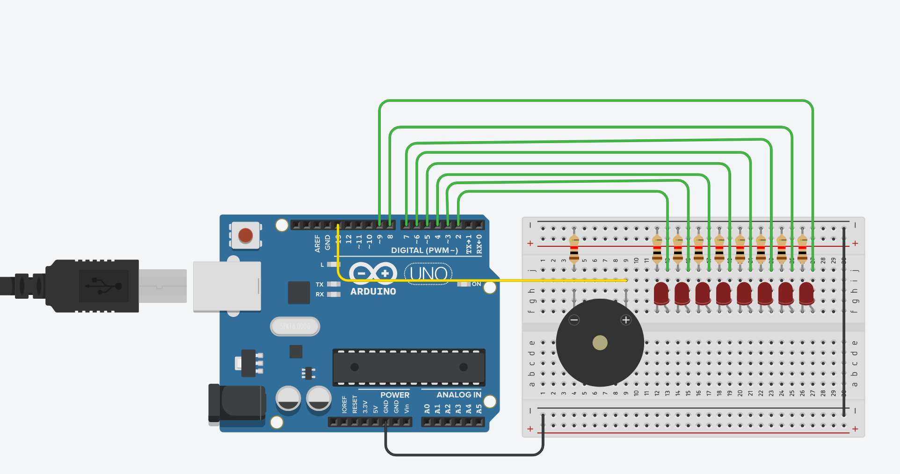

# Buzzer

A small Arduino prototype for reviewing a class exercise. I recreated the circuit in Tinkercad based on the instructor's example.

The buzzer plays eight notes from C4 to C5 while the LEDs light up from left to right. It runs once. Press **RESET** to play again.

## Wiring

- **Buzzer:** positive pin to D13; negative pin through a series resistor to GND. Use a passive piezo buzzer.
- **LEDs:** positive legs to D2–D9, from left to right. Connect each negative leg through its own 220–330 Ω resistor to GND.
- Connect both breadboard ground rails to Arduino GND.

## Run

1. Open [BuzzerDemo.ino](BuzzerDemo/BuzzerDemo.ino) in Arduino IDE.
2. Install **Arduino AVR Boards**, then select **Arduino Uno** and your USB port.
3. Match the wiring above and click **Upload**.

**Checked:** compiles for Arduino Uno. This version has not been tested on hardware or in simulation.
